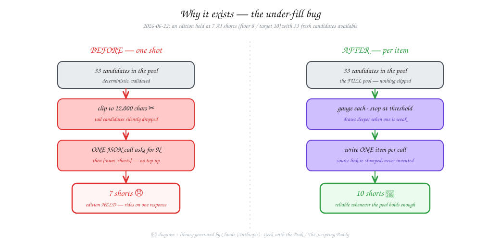
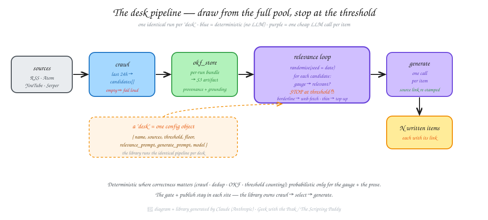
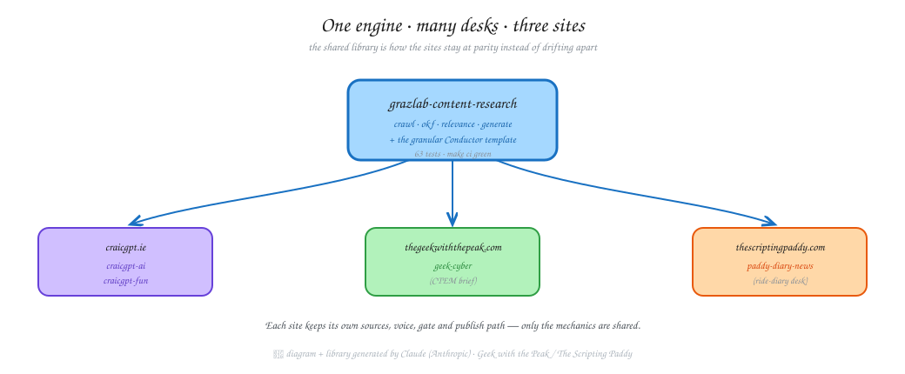

<div align="center">


# grazlab-content-research

**A shared, deterministic content-research engine.**
*Crawl → ground → randomise → relevance-loop (stop at the threshold) → generate one item at a time.*

[](https://github.com/allthingsclowd/grazlab-content-research/actions/workflows/ci.yml)


-d0bfff)

</div>

> [!NOTE]
> **This repository is entirely AI-generated.** Every line of code, every test, this
> README and its diagrams were written by **Claude (Anthropic)** working as Graham
> Land's pair-programmer, under human direction and review. It is the daily-content
> brains behind the **Geek with the Peak / Scripting Paddy** sites — published openly
> so the approach (and its mistakes) are out in the open.

---

## Why it exists

Graham runs three automated content sites. Each one used to generate a whole section
of its edition in **one big LLM call** over a candidate pool that was **clipped to a
fixed character budget**, then **truncated to N with no top-up**. So the number of
items you got rode entirely on a single model response.

On **2026-06-22** the AI desk held an edition at **7 shorts** (floor 8, target 10)
even though **33 fresh, validated candidates** were sitting right there. The clip hid
the tail; the truncate never back-filled. Classic single-shot fragility — and it got
worse the moment the inference engine changed.

<div align="center">

</div>

The fix is this library: draw from the **full** pool, judge each candidate with one
cheap call, **stop at the threshold**, and write each item **individually** — so the
count is reliable whenever the pool actually holds enough relevant material.

---

## How it works

<div align="center">

</div>

The engine is **deterministic where correctness matters** (crawling, dedup, the OKF
bundle, counting to the threshold) and **probabilistic only** for the two things that
genuinely need judgement: the per-item relevance gauge and the per-item prose. The
shuffle is seeded by the run date, so the same day reproduces the same selection.

| Stage | Module | What it does |
|-------|--------|--------------|
| **crawl** | `crawl.py` | RSS / Atom / YouTube + Serper news/video over the last 24h → `Candidate[]`. Empty pool ⇒ **fails loudly**, never a silent thin edition. |
| **okf_store** | `okf_store.py`, `okf.py` | Persists the pool as a per-run [Open Knowledge Format](https://github.com/GoogleCloudPlatform/knowledge-catalog) bundle to S3 — provenance **and** judge-grounding, one concept per candidate. |
| **relevance** | `relevance.py`, `agent.py` | Randomise → gauge each candidate (one structured call) → **stop at the threshold**. Borderline items get a web-fetch tie-breaker; a thin pool gets a Serper top-up. |
| **generate** | `generate.py` | Writes **one item per call**; the candidate's real source link is **re-stamped** onto the output — a model can never smuggle in an invented URL. |
| **pipeline** | `pipeline.py` | The four granular stages with S3-key passing, plus `run_desk()` to run a whole desk in one process. |
| **conductor** | `conductor.py` | Emits a granular, one-task-per-stage [Conductor](https://conductor-oss.org/) workflow + task-defs, so every box is independently visible and retriable. |
| **providers** | `providers.py`, `config.py` | LiteLLM-routed, local-first with frontier fallback; truthful model attribution. Point `LITELLM_BASE_URL` at any OpenAI-compatible endpoint. |

### The hard invariant

Every `Candidate` carries a **real http(s) source link** — it can't be constructed
without one, and `generate` re-stamps it onto the written item. A piece with no
verifiable source is never emitted.

---

## A "desk" is the unit of reuse

A desk is one config object; the library runs the identical pipeline for every desk.

```python
from grazlab_content_research import Desk, FeedSource, run_desk

ai_desk = Desk(
    name="ai",
    sources=[FeedSource("Hugging Face", "https://huggingface.co/blog/feed.xml", desk="ai")],
    threshold=10,                       # how many items to select + write
    relevance_prompt="Relevant = a genuine frontier-AI development.",
    generate_prompt="Write a punchy, plain-English short.",
    model="local/qwen", fallback_model="frontier/model",
    okf_concept_type="AIStory",
)

result = run_desk(
    ai_desk, date="2026-06-23",
    put_json=put, get_json=get,        # your S3 helpers (injected)
)
# result["written_key"] → working/research/2026-06-23.ai.written.json  (exactly `threshold` items)
```

<div align="center">

</div>

Each site keeps its **own** sources, voice, gate and publish path — only the mechanics
are shared. That's the whole point: the sites stay at **parity** instead of drifting
apart, which is exactly how the under-fill bug slipped into one and not the others.

---

## Quickstart

```bash
make bootstrap   # uv sync + pre-commit install
make lint        # ruff check + format --check
make typecheck   # mypy (the package ships py.typed)
make test        # pytest  (63 tests, all I/O injected → fully offline)
make ci          # all of the above
```

Add it to your project (PEP 621 / uv):

```toml
[project]
dependencies = ["grazlab-content-research"]

[tool.uv.sources]
grazlab-content-research = { git = "https://github.com/allthingsclowd/grazlab-content-research.git", branch = "main" }
```

---

## Design notes

- **Loud on empty.** A crawl that returns nothing raises `CrawlEmpty` — a thin pool
  fails its stage rather than quietly publishing a hollow edition.
- **Everything probabilistic is injected.** `gauge`, the borderline refiner, the
  top-up search and the per-item writer are all callables you pass in; their real
  LLM-backed implementations live in `agent.py`. That's why the suite runs offline.
- **Per-run OKF bundle.** Doubles as provenance and as grounding for an independent
  judge — so a judge checks claims against *the research that produced them*, not its
  own training data.
- **Conductor-granular.** One task per stage per desk: every box is visible and
  retriable in the UI; the deterministic crawl/okf stages are cacheable.

---

## Credits & licence

Built by **Claude (Anthropic)** for **Graham Land** — *Geek with the Peak / The
Scripting Paddy* ([allthingscloud.eu](https://allthingscloud.eu)). Part of the
`grazlab` homelab content stack alongside [craicgpt.ie](https://craicgpt.ie),
thegeekwiththepeak.com and thescriptingpaddy.com.

Released under the [MIT Licence](LICENSE). The diagrams above are authored in an
Excalidraw style; their SVG sources live in [`docs/diagrams/`](docs/diagrams).
